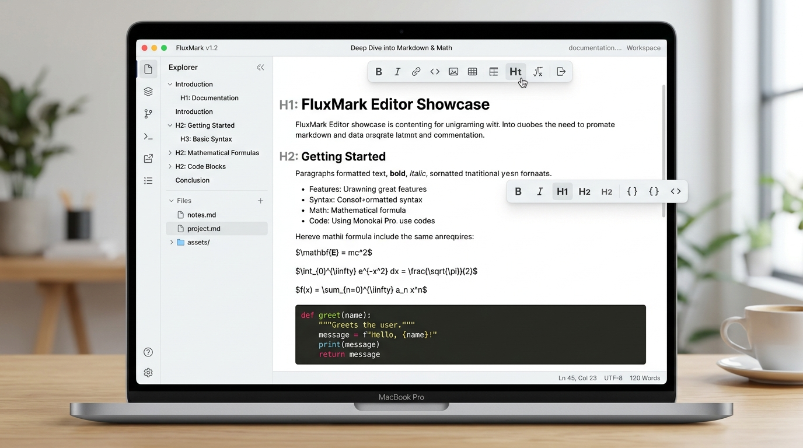
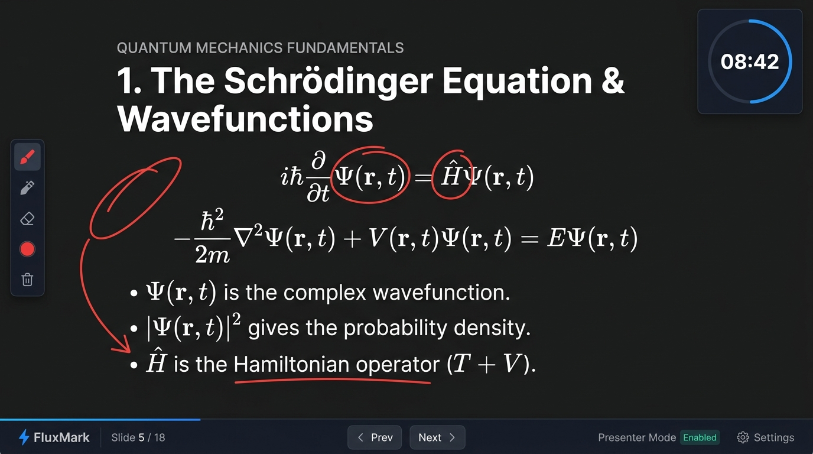

# FluxMark ✦ 智能 Markdown & 全屏演示平台

<p align="center">
  <strong style="font-size: 1.2rem;">下一代 Typora 风格所见即所得编辑器 | 本地优先 | AI 写作助手 | 精选模版库 | KaTeX 科学公式 | 全屏幻灯片放映</strong>
</p>

<p align="center">
  <a href="https://github.com/Crazyer-Flove/FluxMark"></a>
  <a href="https://react.dev/"></a>
  <a href="https://www.typescriptlang.org/"></a>
  <a href="https://tailwindcss.com/"></a>
  <a href="https://tiptap.dev/"></a>
  <a href="https://katex.org/"></a>
  <a href="LICENSE"></a>
</p>

> 🔗 **官方 GitHub 仓库**：[https://github.com/Crazyer-Flove/FluxMark](https://github.com/Crazyer-Flove/FluxMark)

---

## 📸 界面预览 (Showcase)

### ✍️ 1. 主编辑界面 (Typora 风格所见即所得)

FluxMark 打破了传统 Markdown 编辑与预览分屏的割裂体验，提供沉浸式即时渲染编辑视角，支持代码块高亮、数学公式嵌入、选区浮动工具栏与结构化文档大纲。



### 📺 2. 全屏 PPT 演示放映模式

无需导出 PDF 或转换软件，使用 `---` 划定分页后按 `F11` 即可将 Markdown 文档转化为全屏幻灯片放映，内置荧光画笔、激光笔、倒计时与随机抽查点名转盘。



---

## ✨ 核心功能特性

### 📝 1. 所见即所得编辑 (WYSIWYG Editing)
* **Typora 风格流畅渲染**：无需分屏对比，输入 Markdown 语法（如 `#`、`**`、`*`、`==`、`>`、`---`）瞬间转为优美的富文本排版。
* **智能 Markdown 输入规则**：支持 `****加粗****`（3/4星号兼容）、`**粗体**`、`*斜体*`、`==文本高亮==`、`~删除线~` 等极速录入。
* **选区浮动工具栏**：选中任意文本自动唤起上下文高亮笔、字号调整、颜色对齐与✨ **一键智能排版（盘古中英文空格规范）**。

### 🎨 2. 精选示例模版库 (Template Center)
内置 6 大开箱即用的专业文档示例模版，覆盖多场景办公与学术写作：
1. **🌟 极简全景指南与全功能演示**：涵盖文本修饰、任务清单、KaTeX 公式、代码与 PPT 放映。
2. **💻 软件工程架构与技术设计文档**：规范的分布式架构设计、组件拓扑表与 TypeScript/Go 代码接口。
3. **🎓 学术论文与科研推导报告**：包含摘要、高阶 KaTeX 积分与矩阵推导方程、对比实验数据表。
4. **📝 项目敏捷周报与团队会议纪要**：产品与工程敏捷迭代周报、任务完成度及待办事项追踪。
5. **📊 高级全栈工程师专业简历**：排版优雅高颜值的求职简历示例，突出核心能力与项目经历。
6. **📺 全屏 PPT 演讲汇报专用幻灯片**：使用 `---` 完美分页的现场展示 Slides 模版。

### 🤖 3. 多模型 AI 智能写作与对话助手
* **多模型兼容**：支持 Gemini API、DeepSeek 官方、OpenAI (GPT-4o)、硅基流动 SiliconFlow、OpenRouter、Moonshot Kimi、智谱 GLM 与 Ollama 本地模型。
* **上下文感知写作**：内置文章润色、扩写、精简总结、语法纠错与多语言翻译，可直接对选中选区或全文发送 AI 命令。

### 📐 4. KaTeX 科学计算与数学公式渲染
* **全功能 KaTeX 引擎**：秒级渲染行内公式（如 `$E=mc^2$`）与块级高阶方程（如微积分积分 $\int$、矩阵 $\mathbf{A}\mathbf{x}=\lambda\mathbf{x}$）。
* **可视化公式交互**：双击公式即可唤起嵌入式公式编辑框，实时修改预览。

### 📺 5. 全屏 PPT 演示放映与课堂互动
* **快捷幻灯片分页**：使用三连减号 `---` 划分幻灯片，按 `F11` 或点击顶部“放映”按钮一键进入演示视界。
* **互动标注工具箱**：
  * 🖋️ **画笔与荧光笔**：演示过程中直接在屏幕上圈画重点。
  * 🧹 **橡皮擦与一键清屏**：轻松清除画面上的所有批注迹象。
  * 🔦 **激光笔模式**：聚焦听众视线焦点。
  * ⏱️ **倒计时计时器**：支持 1~30 分钟或自定义分钟数，严格掌控演讲或课堂讨论节奏。
  * 🎯 **随机点名转盘**：课堂提问与团队会议抽签互动神器。
  * 🎨 **放映背景图案样式**：可自由切换 Slate 质感、暗夜星空、网格网点与自定义渐变。

### 📝 6. 交互式待办清单 (Task List)
* **可点击复选框**：在编辑与预览视界中直接点击方框切换待办状态，带有优雅的删除线完成动画。

### 💻 7. 代码块与语法高亮 (Syntax Highlighting)
* **多语言代码高亮**：自动识别 TypeScript, JavaScript, Python, C++, Rust, HTML/CSS, Go 等主流语言。
* **快捷复制与格式化**：代码块右上角提供一键复制代码与语言切换标牌。

### 🖼️ 8. 图像处理与裁剪 (Image Processing)
* **多渠道图片插入**：支持本地拖拽、剪贴板粘贴与网络 URL 链接插入。
* **内置图片裁剪器 (Image Cropper)**：双击图片唤起自适应比例裁剪、缩放与旋转换图。
* **工作区 `.med` 文件夹同步**：关联本地文件夹后，上传的资源自动同步存入 `.med` 目录，生成相对路径连接。

### 🔒 9. 100% 本地优先与隐私安全 (Privacy First)
* **本地化数据存储**：所有文章资产存储在浏览器的 LocalStorage / IndexedDB 及本地文件系统。
* **零后台上传**：不建立任何私密文档的云端数据库备份，绝不泄露个人写作数据。

### 📤 10. 多维度全格式导出 (Multi-format Export)
* **Markdown (`.md`)**：保持纯正格式一键保存。
* **HTML (`.html`)**：导出带自包含 CSS 样式的立即可用网页。
* **Word (`.docx`)**：转化生成标准 Microsoft Word 文档。
* **高清图片 (`.png`)**：生成带优雅边框与自定义采样像素密度的沉浸式长图卡片。
* **PDF (`.pdf`)**：完美调用 DOM 画布与系统打印引擎输出无瑕疵 PDF。

---

## ⌨️ 快捷键速查表 (Shortcuts Guide)

FluxMark 提供了极其丰富的键盘快捷键支持，按 <kbd>Ctrl</kbd> + <kbd>/</kbd> 可随时唤起帮助中心。

| 模块类别 | 功能说明 | 键盘快捷键 / 入口 | 作用 |
| :--- | :--- | :--- | :--- |
| **文本与格式** | 文本加粗 | <kbd>Ctrl</kbd> + <kbd>B</kbd> | 加粗选中文本 |
| **文本与格式** | 文本斜体 | <kbd>Ctrl</kbd> + <kbd>I</kbd> | 倾斜选中文本 |
| **文本与格式** | 文本高亮 | <kbd>Ctrl</kbd> + <kbd>Shift</kbd> + <kbd>H</kbd> | 叠加荧光高亮色 |
| **文本与格式** | 标题切换 | <kbd>Ctrl</kbd> + <kbd>Alt</kbd> + <kbd>1 / 2</kbd> | 快捷转换为一/二级标题 |
| **文本与格式** | 待办清单 | <kbd>Ctrl</kbd> + <kbd>Shift</kbd> + <kbd>9</kbd> | 插入交互式复选框 |
| **文本与格式** | 标题补全 | <kbd>#</kbd> + <kbd>Space</kbd> | 行首快速转标题 |
| **文件管理** | 保存文档 | <kbd>Ctrl</kbd> + <kbd>S</kbd> | 写入文件系统或更新本地缓存 |
| **文件管理** | 打开文件 | <kbd>Ctrl</kbd> + <kbd>O</kbd> | 读取本地 `.md` 或 `.txt` 文件 |
| **文件管理** | 新建文档 | <kbd>Ctrl</kbd> + <kbd>Alt</kbd> + <kbd>N</kbd> | 新建空白文档 |
| **文件管理** | 撤销 / 重做 | <kbd>Ctrl</kbd> + <kbd>Z</kbd> / <kbd>Ctrl</kbd> + <kbd>Y</kbd> | 撤销与重做编辑步骤 |
| **精选模版** | 模版库 | 文件 -> 精选示例模版 | 选择并快速载入 6 大精选场景模版 |
| **全屏放映** | 开启/退出 PPT | <kbd>F11</kbd> | 进入/退出全屏演示放映 |
| **全屏放映** | 切换幻灯片 | <kbd>←</kbd> / <kbd>→</kbd> / <kbd>Space</kbd> | 播放上一页或下一页 |
| **系统辅助** | 一键智能排版 | 选区浮动工具栏 ✨ | 自动校正中英文空格与盘古规范 |
| **系统辅助** | 帮助中心 | <kbd>Ctrl</kbd> + <kbd>/</kbd> | 唤起新手教程与快捷键查询 |

---

## 🛠️ 项目技术栈 (Tech Stack)

| 领域 | 选用技术 / 依赖 | 说明 |
| :--- | :--- | :--- |
| **前端核心** | React 19 + TypeScript 5.8 | 高性能 UI 交互与强类型安全保证 |
| **构建工具** | Vite 6 | 秒级 HMR 与高效生产构建 |
| **编辑引擎** | TipTap v3 (ProseMirror) | 可扩展的模块化富文本编辑框架 |
| **样式 UI** | Tailwind CSS v4 + Lucide Icons | 响应式设计与精致现代化矢量图标 |
| **动效过渡** | Motion (Framer Motion) | 丝滑弹窗、模版卡片、幻灯片翻页与浮动栏过渡 |
| **数学公式** | KaTeX | 高性能 LaTeX 科学公式渲染 |
| **AI 大模型** | Gemini, OpenAI, DeepSeek | 多模型原生 API Fetch 支持 |
| **文档导出** | `html-to-image`, `html2canvas`, `jspdf`, `docx` | 多格式无损转码导出与 fallback 引擎 |

---

## 🏗️ 项目目录结构 (Directory Structure)

```text
fluxmark/
├── public/                     # 静态资源 (图标、默认图片)
├── src/
│   ├── assets/                 # 示例展示图片资产
│   │   └── images/
│   ├── components/             # 可复用组件与模态框
│   │   ├── AIChat.tsx          # AI 智能写作与对话设置面板
│   │   ├── DocumentOutlineStats.tsx # 实时大纲与字数统计
│   │   ├── HighlightPopover.tsx# 高亮色块选择器
│   │   ├── ImageCropperModal.tsx# 图片自适应裁剪模组
│   │   ├── MathematicsComponent.tsx # KaTeX 公式编辑交互
│   │   ├── NewFileModal.tsx    # 新建文件模态框
│   │   ├── PDFExportModal.tsx  # PDF / 长图卡片导出中心
│   │   ├── PresBgModal.tsx    # 全屏演示背景样式设置
│   │   ├── PrivacyModal.tsx    # 隐私说明与安全验证
│   │   ├── SponsorModal.tsx    # 赏赞打赏模组 (支持自定义收款码)
│   │   ├── StudentPickerModal.tsx# 课堂与会议随机点名转盘
│   │   └── TemplateModal.tsx   # 精选示例模版选择模组
│   ├── data/
│   │   └── templates.ts        # 6 大场景精选文档示例模版数据集
│   ├── extensions/             # TipTap 自定义编辑器插件扩展
│   │   ├── CustomFormattingInputRules.ts # 智能 Markdown 符号录入规则
│   │   ├── EmojiSuggestion.ts  # Emoji 表情自动补全
│   │   ├── HeadingSuggestion.ts# 标题层级智能建议
│   │   ├── Mathematics.ts      # KaTeX 数学节点扩展
│   │   └── Video.ts            # 多媒体视频嵌入扩展
│   ├── lib/                    # 工具库与解析器 (markdown, katex, etc.)
│   ├── utils/                  # 智能格式化 (smartFormat) 与媒体库辅助 (mediaRegistry)
│   ├── App.tsx                 # 主应用逻辑、菜单栏、放映视界与状态调度
│   ├── index.css               # Tailwind CSS 全局样式与 ProseMirror 样式重置
│   └── main.tsx                # 应用入口
├── package.json
├── vite.config.ts
└── README.md
```

---

## 🚀 快速开始 (Getting Started)

### 1. 环境准备
确保您的开发环境中已安装 [Node.js](https://nodejs.org/) (推荐 `v18.0.0` 或更高版本) 以及 `npm`。

### 2. 克隆仓库与安装依赖

```bash
# 克隆仓库
git clone https://github.com/Crazyer-Flove/FluxMark.git
cd FluxMark

# 安装项目依赖
npm install
```

### 3. 配置环境变量

在项目根目录下复制 `.env.example` 并重命名为 `.env`：

```bash
cp .env.example .env
```

在 `.env` 中填写您的 **Gemini API Key**（若需要使用内置 Gemini 服务）：

```env
# Gemini 大模型 API 密钥 (仅服务器端代理调取，保护密钥安全)
GEMINI_API_KEY=your_gemini_api_key_here
```

*注：您也可以在应用侧边栏 AI 对话窗口中直接输入自己的 DeepSeek / OpenAI / SiliconFlow / Ollama 密钥。*

### 4. 启动开发服务器

```bash
npm run dev
```

启动后，在浏览器中打开 `http://localhost:3000` 即可体验 FluxMark 智能编辑！

### 5. 构建生产版本

```bash
npm run build
```

打包生成的文件将置于 `dist/` 目录中，可部署至任何静态托管平台（如 Cloudflare Pages, Vercel, Netlify）或 Docker 容器中。

---

## 💖 赏赞与支持 (Support)

如果您觉得 FluxMark 为您的学习、创作或教学演示带来了便利，欢迎给予打赏支持或提交 GitHub Star 🌟！

在应用的“赞赏”模组中，支持**直接替换为您自己的微信或支付宝收款码**（只需点击“上传/更换收款码”，或在源码中替换 `/public/wechat-qr.jpg` 和 `/public/alipay-qr.jpg`）。

---

## 📄 开源协议 (License)

本项目基于 [MIT License](LICENSE) 协议开源，欢迎自由分发与二次开发。

---

<p align="center">
  <strong>FluxMark - 灵感流淌，极致表达。</strong><br />
  Made with ❤️ for writers, students, researchers, and creators.
</p>
