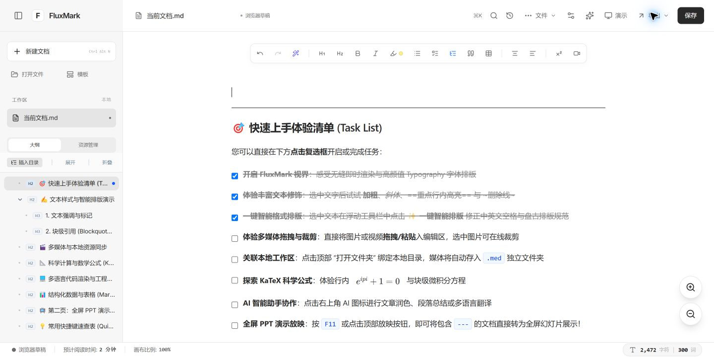
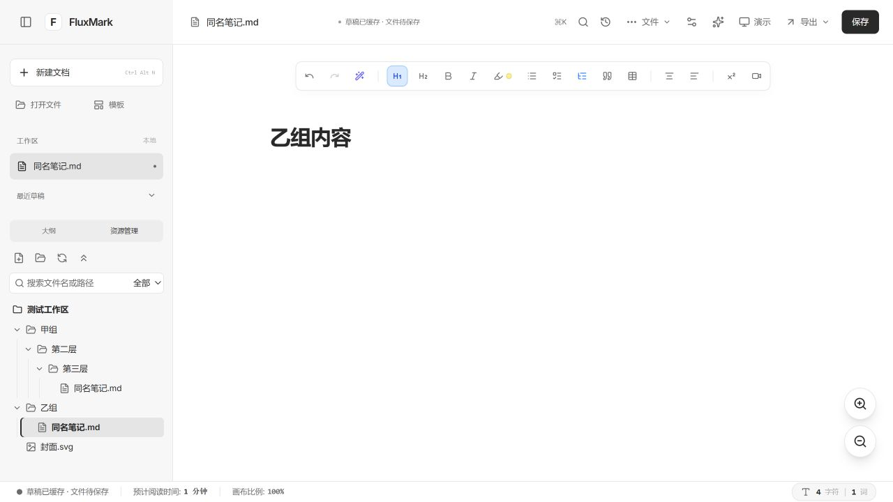
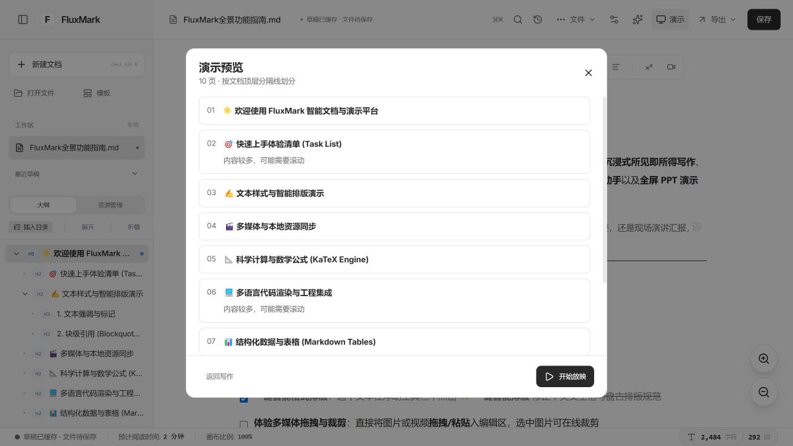
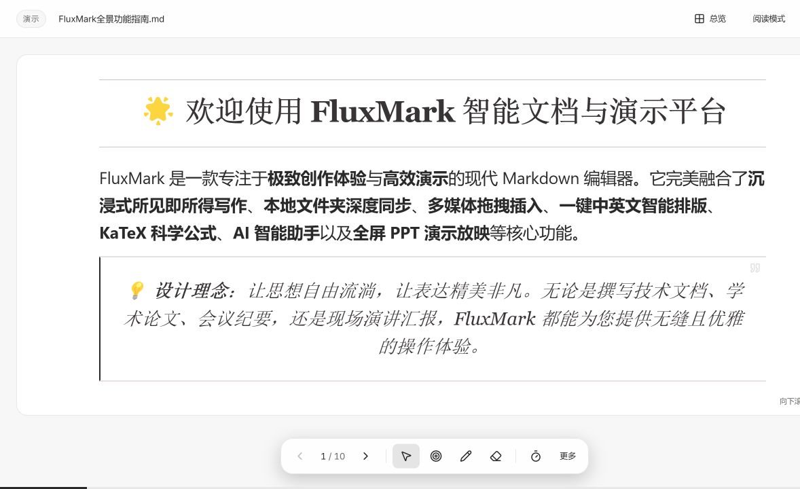
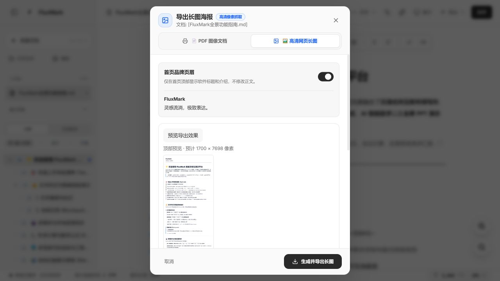

# FluxMark

FluxMark 是一个本地优先的 Markdown 编辑与放映工具。用它写文档、管理笔记，并把用 `---` 分隔的内容直接变成幻灯片。

[在线版](https://fluxmark.vercel.app) · [Windows 安装与构建说明](docs/WINDOWS.md) · [GitHub Releases](https://github.com/Crazyer-Flove/FluxMark/releases) · [更新记录](CHANGELOG.md)



## 快速开始

1. **打开文档。** 在文件浏览器创建或导入 Markdown，也可在支持文件夹访问的浏览器中打开本地工作区。
2. **写作与组织。** 支持标题、列表、任务清单、引用、表格、代码高亮和 KaTeX 公式。用 `[[文档名]]` 建立双链，在大纲、反向链接和知识星图中浏览关系。
3. **开始放映。** 在文档中用独占一行的 `---` 分页，点击顶部「演示」，检查页面后开始放映。用方向键翻页。触控屏在「浏览」模式下支持双指缩放和单指拖动，翻页恢复默认比例。
4. **导出与分享。** 从「导出」菜单选择 Markdown、PDF、PNG 长图、Word 或 HTML。PDF 和长图可预览，并可控制是否添加 FluxMark 页眉。

| 界面 | 用法 |
| --- | --- |
|  | 从左侧文件树打开文档，按文件名或路径搜索。 |
|  | 开始前检查分页，必要时返回对应的编辑位置。 |
|  | 用自适应模式展示密集内容，也可用画笔、激光笔和倒计时。 |
|  | 在导出前检查排版与页眉。 |

应用外观提供白、黑、米黄和天蓝四种主题，Markdown 正文皮肤可从编辑区工具栏独立切换。

在 Windows 桌面版和支持相应手势的 Chromium 浏览器中，触控板双指捏合可缩放整个工作区，按 `Ctrl + 0` 恢复 100%。放映浏览模式下，同一手势缩放当前幻灯片。

## 数据与 AI

浏览器草稿保存在当前应用配置文件的本地存储中。清理站点数据或更换配置文件前，请导出重要文档。文件与文件夹功能取决于浏览器权限，建议在支持 File System Access API 的 Chromium 浏览器中使用网页版。

AI 助手需配置所选服务商。使用 AI 时，所选择的文档内容会随请求发送给该服务商。外链图片和字体可能发起网络请求。

## 开发

需要 Node.js 22.12+ 与 npm。

```bash
npm ci
npm run dev
npm run lint
npm run build
```

开发服务器默认监听 3000 端口。Windows 桌面预览使用 `npm run desktop`，生成安装程序使用 `npm run package:win`。更多说明见 [Windows 文档](docs/WINDOWS.md)。

源码按 [MIT License](LICENSE) 发布。

提交前可用[功能回归清单](docs/TESTING.md)检查网页版和 Windows 版。
